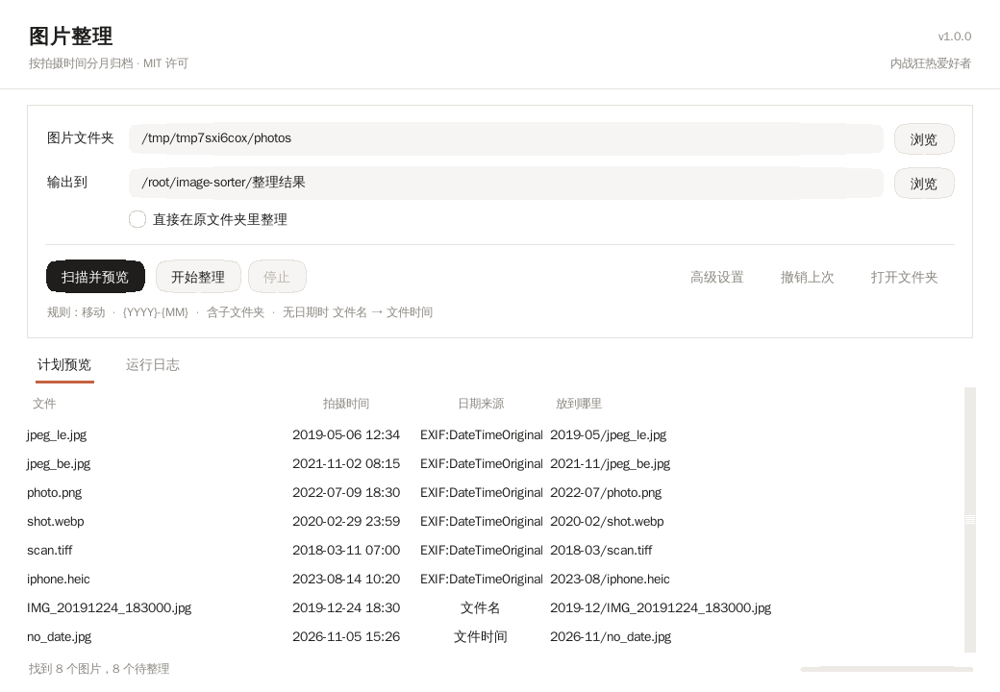
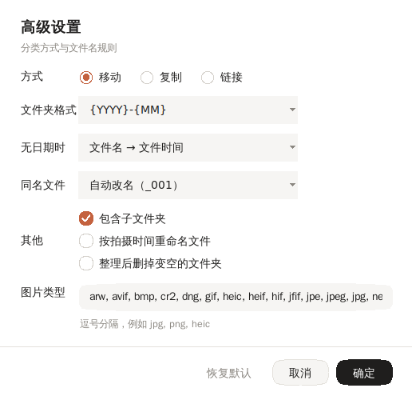

# 图片整理

把散在各处的图片按拍摄时间分到月份文件夹里。纯 Python 写，不依赖第三方库，打包后是一个 exe。

MIT 许可 · 作者：内战狂热爱好者



## 运行

有 Python（3.9 以上）：

```
python main.py
```

或者双击 `run.bat`。

没有 Python 的电脑，先双击 `build.bat` 打包：

```
dist\ImageSorter.exe
```

这个 exe 复制到别的电脑就能用。

## 界面

上面两个框：左边选图片所在的文件夹，右边填输出位置。默认输出到程序目录下的 `整理结果`，不想改就直接用。勾上「直接在原文件夹里整理」，图片就留在原地分好类，不往外搬。

点「扫描并预览」，下面会列出每个文件将要去哪里。看完没问题再点「开始整理」。整理错了点「撤销上次」，文件会搬回原来的位置。



移动还是复制、文件夹怎么命名、没日期的怎么办、重名怎么办，这些都在「高级设置」里。改完点确定，主界面那行小字会跟着变；点取消就全还原。

三种处理方式：

- 移动：整理完原位置不再保留
- 复制：源文件不动，多占一份空间
- 链接：只建硬链接，源文件不动，也不占额外空间。要求源和目标在同一个磁盘、文件系统支持硬链接（NTFS 可以，FAT32/exFAT 不行），不支持时会自动退回复制并在日志里说明

「整理后删掉变空的文件夹」适合收拾相机卡：图搬完了，留一堆空目录没意义。只删因为这次整理而变空的目录，里面还有别的文件的不会动。

## 时间从哪来

按下面的顺序找，找到就用：

| 顺序 | 来源 | 说明 |
|---|---|---|
| 1 | EXIF `DateTimeOriginal` | 相机记下的拍摄时间，最可靠 |
| 2 | EXIF `DateTimeDigitized` | 数字化时间 |
| 3 | EXIF `DateTime` | 文件时间，相机写入 |
| 4 | XMP `CreateDate` / `photoshop:DateCreated` | 修图软件、扫描件常放这儿 |
| 5 | PNG `Creation Time` | PNG 的文本块 |
| 6 | 视频文件头 `mvhd` | mp4/mov/m4v/3gp 的拍摄时间 |
| 7 | 文件名里的日期 | `IMG_20191224_183000`、`2019-05-06 12.34.56`、微信的 `mmexport1687654321000` |
| 8 | 文件修改时间 | 最后兜底 |

第 6、7 条由「无日期时」这个下拉框控制。默认是先用文件名，文件名里没有再看修改时间。

## 支持的格式

分两类。第一类能直接从文件里读出拍摄时间：

| 类型 | 扩展名 |
|---|---|
| JPEG | jpg jpeg jpe jfif |
| PNG | png |
| WebP | webp |
| TIFF | tif tiff |
| HEIF | heic heif avif hif |
| RAW | dng cr2 nef arw orf rw2 pef srw |
| 视频容器 | mp4 mov m4v 3gp 3g2 |

第二类会被正常整理，但文件里没有可读的拍摄时间，只能靠文件名里的日期或文件修改时间：

| 类型 | 扩展名 |
|---|---|
| 位图 | gif bmp |
| 视频容器 | avi mkv webm wmv flv |

这两类都在默认的「图片类型」列表里。

关于 RAW：dng、cr2、nef、arw 这些本身是 TIFF 容器，解析走的是同一条路径，测试里用 TIFF 结构加对应后缀验证过。真机上的 RAW 如果某个厂商把日期放进了私有字段，会退到文件名或文件时间，不会出错。

HEIC 是自己解析的，不需要装任何东西。高级设置里的「图片类型」可以增删。

## 文件命名

默认用拍摄时间给文件改名，`20190506_123456.jpg`。这样在任何文件管理器里都是时间顺序，不再依赖相机给的编号。

同一秒拍的多张会冲突，自动加 `_001`。不想要这个行为就在高级设置里关掉「按拍摄时间重命名文件」，保留原文件名。

已经在月份文件夹里的文件不会被重复搬动，但名字必须真的对：

- 名字是 `IMG_0001.jpg` 这种，会就地改名
- 名字是 `20230506_123456.jpg` 但 EXIF 写的是 2020-03-15，同样会纠正成 `20200315_100000.jpg`
- 名字里的时间等于拍摄时间，才判为「已在位」跳过

判断依据是时间数值的比对，不是看名字像不像。

## 重复文件

内容完全相同的文件只保留一张，其余的不留在输出目录里：默认挪进 `.imagesorter_undo/trash/时间戳/`，撤销能把它们放回原处。高级设置里可以改成直接删除，不可恢复。

判断是逐字节比对，不是看文件名或大小。先按大小分组，只有大小相同的才去算哈希，所以整库扫描不会变慢。

## 文件夹命名

模板里能用的占位符：

| 占位符 | 结果 |
|---|---|
| `{YYYY}` | 2023 |
| `{YY}` | 23 |
| `{MM}` | 05 |
| `{M}` | 5 |
| `{MMM}` | May |
| `{DD}` `{D}` | 09 / 9 |

用 `/` 或 `\` 分隔会生成多级目录。默认 `{YYYY}-{MM}`，也就是 `2023-05`。

已经按当前模板整理过的文件，再扫描时会认出来，不会重复搬。换了模板，旧目录就对不上了，会按新模板重新归类。

## 命令行

```
python cli.py --source "D:\照片"                      只预览
python cli.py --source "D:\照片" --apply              真的整理
python cli.py --source "D:\照片" --target "E:\图库" --apply
python cli.py --source "D:\照片" --mode copy --layout "{YYYY}/{MM}" --apply
python cli.py --source "D:\照片" --undo-list          看有哪些撤销记录
python cli.py --source "D:\照片" --undo-latest        撤销最近一次
```

想知道某个文件为什么被归到那个月份、为什么叫那个名字：

```
python cli.py --explain "D:\照片\IMG_0001.jpg"
```

它会把这个文件里能读到的所有时间字段、最终采用哪一个、整理后会叫什么名字都列出来，还会比对文件名里的时间和拍摄时间是否一致。

参数全在 `python cli.py --help` 里。

## 撤销

每次整理都会在输出目录下写一份 `\.imagesorter_undo\undo-时间戳.json`，记下每个文件的去向。

撤销时倒着走一遍：移动的把文件搬回去，复制的把副本删掉，顺手清理这次生成的空文件夹。

如果整理完你又往原位置放了同名文件，撤销会跳过那一条并在日志里说明，不会覆盖你放的东西。

## 几个已知情况

- 扫描阶段只读文件，不动磁盘上的任何东西。
- 默认不覆盖同名文件，会自动加 `_001` 这样的后缀。高级设置里可以改成覆盖或跳过。
- 输出位置已经有内容完全一样的文件时直接跳过，不会多出一份副本。判断是逐字节比对的，不只看文件名。
- 一个文件失败不影响其他文件，失败项单独列在日志里。
- 路径超过 260 个字符时会自动用 `\\?\` 长路径写法。
- 0 字节的图片和读不到的图片会被跳过，在预览里标出来。
- 视频不在处理范围内，只认图片。

## 常见问题

**时间不对**：相机时钟错了会写进 EXIF，这种只能手动改。先按月份整理一遍，再单独处理那几张。

**iPhone 的 HEIC 读不到时间**：标准 HEIC 都能读；个别改过容器的会退到文件名或修改时间，日志里的「日期来源」列会写实际用了哪一条。

**整理到一半中断**：已经搬走的不受影响，重新扫描一次接着来就行，重复的会被认作已在正确位置。

**能选整个 C 盘吗**：可以，但系统壁纸、程序图标也会被搬走。建议只选放照片的目录，真要整盘先看看预览。

## 目录

```
image-sorter/
├─ main.py                    入口
├─ cli.py                     命令行
├─ run.bat / build.bat        运行 / 打包
├─ imagesorter/
│  ├─ exif.py                 元数据解析（JPEG/PNG/WebP/TIFF/HEIC）
│  ├─ dates.py                日期解析、模板渲染、长路径
│  ├─ scanner.py              扫描，生成计划
│  ├─ organizer.py            执行、撤销、失败隔离
│  ├─ gui.py                  界面
│  └─ config.py               设置保存
├─ docs/                      截图
├─ tools/grab_screenshot.py   截图脚本（开发用）
└─ tests/
   ├─ make_samples.py         造带 EXIF 的测试样本
   ├─ test_core.py            核心逻辑
   ├─ test_gui_smoke.py       无显示器环境的界面构建测试
   └─ manual_gui_check.py     有显示器时的整体流程脚本
```

## 测试

```
python -m unittest discover -s tests -t .
```

38 个用例。造样本是用代码一个字节一个字节拼出来的 JPEG（大小端各一份）、PNG、WebP、TIFF、HEIC，不是拿别人的库互相验证。覆盖日期解析、格式读取、分月、重名、移动复制、撤销、只读文件、空文件、中途取消这些情况。

界面另有一个跑真窗口的脚本，需要图形环境：

```
python tests\manual_gui_check.py
```

它会把扫描、整理、撤销整条链走一遍。

## 许可

MIT，全文见 [LICENSE](LICENSE)。

## 致谢

按月份归档、硬链接整理、内容重复检测这几处设计参考了 [phockup](https://github.com/ivandokov/phockup)（MIT，Copyright (c) 2017 Ivan Dokov）。它的 `--link` 和 `--rmdirs` 是本项目「链接」方式与「整理后删掉变空的文件夹」的来源，重复文件也是照它按文件内容比对的思路做的。具体借鉴范围写在 [NOTICE.md](NOTICE.md)。

另外看过 [elodie](https://github.com/jmathai/elodie) 和 [GooglePhotosTakeoutHelper](https://github.com/TheLastGimbus/GooglePhotosTakeoutHelper) 的产品形态，没有用它们的代码。

## 在 Windows 上实测过

Windows Server 2025 + Python 3.8.6：

- 35 个用例全过
- 命令行实际整理 8 个样本文件，落到 8 个月份目录，0 失败
- 撤销回退 8 个，源目录恢复原样
- 508 个文件里有 322 个字符的超长路径，507 个移动成功、0 失败，撤销同样 0 失败
- `verify.bat` 在 cmd 下跑完并输出“全部通过”
- PyInstaller 打出的 `ImageSorter.exe` 能正常启动

代码兼容 3.8 及以上，因为所有类型注解都用了 `from __future__ import annotations`。
